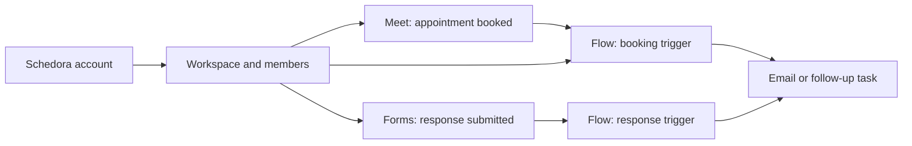

# Schedora product guide and external QA handbook

**Audience:** developers, business analysts, implementation partners and independent QA testers  
**Purpose:** explain what Schedora is, how its products fit together, what can be tested, and how to report results safely.  
**Source of truth:** the current application, API, authorization rules and linked product docs. This guide is a navigation aid, not a promise that every provider or deployment is live.

## 1. Product at a glance

Schedora is a suite of three connected products for small teams:

| Product | Customer job | Typical outcome |
|---|---|---|
| **Meet** | Let people book time without back-and-forth | A confirmed appointment with the right host, calendar state and follow-up |
| **Forms** | Collect information before or after a conversation | A validated submission that a team can review and act on |
| **Flow** | Follow up consistently when a booking or response happens | A traceable email or task, with run status and recovery when something fails |
| **Schedora workspace** | Bring the products, people and records together | One account and workspace with role-based access and shared billing context |

The intended experience is that each product is useful alone and the suite removes repeated handoffs. The initial audience is a product hypothesis, not validated market research. Do not describe Schedora as enterprise-ready or claim measured customer outcomes without separate evidence.

### Design principles

- Make the next useful action obvious and use customer language.
- Put advanced or optional setup behind a clearly named step.
- Show whether an action is a draft, saved, published, queued, delivered, failed or simulated.
- Keep the result and recovery action near the setting that caused it.
- Respect workspace boundaries, permissions, privacy, keyboard access and small screens.
- Use original Schedora wording and visuals. Public products may inform familiar interaction patterns, not copied assets or proprietary implementation.

See [Product design principles](PRODUCT_DESIGN_PRINCIPLES.md), [Vision](../VISION.md), and [Product requirements](../PRD.md).

## 2. How the suite fits together



Meet and Forms can emit workspace-scoped events. Flow can respond to those events with supported email or task actions. These handoffs must preserve the source workspace and avoid exposing unnecessary personal data. A preview or simulation must not be mistaken for a real booking, submission, sent email or completed task.

## 3. Product capabilities

### Meet — scheduling and video

Hosts configure event types, working hours and exceptions. Invitees use a public booking page to select an available time and submit the requested details. Depending on configuration, Meet supports one-on-one, group, collective and round-robin scheduling, one-off booking links, polls, location choices, invitee questions, booking limits, buffers, cancellation/rescheduling and calendar files.

Workspace tools include bookings, event types, availability, connected apps, contacts, reminders, email delivery, analytics and meeting notes/AI. The instant meeting room supports participant controls and session tools; scheduled video availability depends on the configured provider and entitlement.

**Core QA focus:** availability and time zones, competing bookings, correct booking lifecycle, host permissions, cancellation/rescheduling, provider failures and clear status.

More detail: [Meet release checklist](MEET_RELEASE.md), [Meet video](MEET_VIDEO.md), [authorization](AUTHORIZATION.md).

### Forms — authoring and responses

Authors create a blank form or import a supported JSON definition, edit questions and pages, preview, save drafts and publish versioned forms. Supported interactions include short/long text, email, choices, dates, page breaks, conditional display and navigation logic, answer piping, Classic and Conversational layouts, public links and embeds. Responses are validated by the server and can be reviewed or exported by authorized workspace members.

**Core QA focus:** authoring and draft preservation, preview versus published version, required and conditional questions, tampered requests, mobile respondent experience, response access and safe CSV export.

More detail: [Forms product checklist](FORMS_PRODUCT_CHECKLIST.md), [Forms behavior and contracts](FORMS.md).

### Flow — follow-up automation

An administrator creates a draft workflow with a supported trigger (Meet booking or Forms response) and an email or task action. Drafts do not execute. Enabled workflows process matching events; paused workflows hold new events; run history records outcomes and supports retry for eligible failures. Simulation is for safe review and must not send a real email or create a real task.

**Core QA focus:** trigger and workspace matching, draft/paused/enabled behavior, simulation safety, run status, retry idempotency and actionable failures.

### Shared workspace and account

An account may belong to one or more workspaces. A workspace owns its members, product data, connections and billing state. Owners and admins have management capabilities; members have narrower access. The server enforces workspace membership and permission checks on every private request; hiding a screen in the interface is not a security boundary.

More detail: [Authorization matrix](AUTHORIZATION.md), [API guide](API.md), [Product shell](PRODUCT_SHELL.md).

### Plans, setup and public information

The shared account area covers profile, workspace, plans, subscriptions, usage and Meet credits where enabled. Pricing and payment behavior are environment-specific: local evaluation uses a test payment path, and live subscription checkout requires the production payment integration and release gates. Guided setup is available for the whole workspace and for Meet, Forms or Flow individually; setup should save drafts and readiness information without silently publishing or enabling customer-facing behavior. Public product, pricing, privacy and terms pages help visitors understand the service before signing in.

See [Pricing proposal](PRICING_PROPOSAL.md), [Razorpay subscription status](RAZORPAY_SUBSCRIPTIONS.md), [Release acceptance](RELEASE_ACCEPTANCE.md), and [Launch status](../LAUNCH.md) for current caveats. A proposal or configured test path is not proof of live billing.

## 4. Where to find product areas

Routes are relative to the app host. Product subdomains may open the corresponding product at `/`; the suite overview and marketing homepage are separate destinations. The product owner must confirm which domains and provider integrations are actually deployed in the target environment.

| Route | What a tester uses it for |
|---|---|
| `/` | Public Schedora homepage (on the suite host) |
| `/overview` | Signed-in, cross-product workspace overview |
| `/meet` | Meet dashboard; `?tab=` opens bookings, availability, events, video, polls, contacts, reminders, analytics, connections or delivery tools |
| `/meet/event-types/new` | Create an event type; existing event types have an editor route |
| `/meet/<workspace-or-event-link>` | Public booking page; use only links supplied for the test fixture |
| `/meet/manage/<token>` | Invitee booking management link from a test confirmation; treat the token as private |
| `/meet/room/<room>` and `/meet/join/<token>` | Host and guest meeting room for an authorized test session |
| `/forms` | Forms overview and form list |
| `/forms/<form-id>` | Form builder and preview |
| `/forms/<form-id>/responses` | Authorized response inbox for a form |
| `/f/<public-id>` | Public respondent form; test only with a supplied synthetic fixture |
| `/flow` | Flow overview and workflow list; `?tab=connections` shows native connections |
| `/flow/new` and `/flow/<flow-id>` | Create or edit a workflow |
| `/flow/runs` and `/flow/tasks` | Run history and follow-up tasks |
| `/setup`, `/setup/meet`, `/setup/forms`, `/setup/flow` | Suite or product-specific guided setup |
| `/account`, `/billing`, `/enquiries` | Account, subscription/usage and shared enquiry views; permissions vary by role |

Use the in-app navigation when possible so the selected workspace and product context stay clear. Do not invent record IDs or reuse private manage/join links in defect reports.

## 5. Roles and test identities

Use dedicated, synthetic test accounts and data. Never use a real customer account or production personal data for vendor testing.

| Test role | What to verify |
|---|---|
| Public invitee/respondent | Can use only published public links; cannot access workspace records or author tools |
| Workspace member/host | Can manage allowed personal Meet work, view permitted workspace records, and cannot perform owner-only actions |
| Workspace admin | Can manage permitted products and members, but cannot take owner-only billing/ownership actions |
| Workspace owner | Can manage workspace configuration, members and subscription actions allowed in the environment |
| Cross-workspace user | Can switch only among memberships; data from another workspace must remain inaccessible |

Test each role in separate browser profiles or clean sessions. Avoid sharing passwords, cookies, API keys, OAuth secrets or payment credentials in tickets, chat or screenshots. Use the environment's approved identity-provider test users for SSO.

## 6. Environment and evidence rules

Before testing, the Schedora owner or environment operator must provide a written environment card:

| Field | Record before testing |
|---|---|
| Environment | Local, isolated staging, or production (production testing requires a separate written scope) |
| Frontend and API addresses | Approved URLs only |
| Build/revision | Release label or commit recorded by the operator |
| Data store | Confirm it is disposable/isolated for staging; tester must not infer this from a URL |
| Provider mode | Simulated, sandbox/test, or live for each calendar, video, email, identity and payment provider |
| Test accounts | Role and owner of each synthetic account; no secrets in the record |
| Data cleanup | Who removes test workspaces, forms, bookings, contacts and responses, and when |
| Allowed tests | Routes, providers, load limits and actions explicitly in scope |

**Do not submit test data until the environment operator confirms the target database is isolated.** Do not use Vercel preview links for submissions unless their API destination is verified as non-production. Do not run load, concurrency, destructive, payment, email-to-customer or real-provider tests without an approved staging scope.

### Local developer setup

The repository README is the current source for Node version and startup steps. In brief: install backend dependencies, start the app from `backend/`, then use its local address. The local defaults are designed for evaluation: database data is local, email is recorded in an outbox, and payment uses a test provider. Local behavior does not prove deployment configuration or external provider delivery.

Use `npm run check` for syntax/static checks, `npm test` for automated backend tests, and `npm run browser-check` for the repository's browser journeys and responsive layouts. PostgreSQL coverage uses `npm run test:postgres` with an isolated test database. Check the current output and CI for actual results; counts change over time. Never point these commands at a production database.

## 7. External QA test plan

For each case, record **Pass / Fail / Blocked / Not run**, environment, build, role, preconditions, steps, expected result, observed result, and evidence link. A blocked case needs the missing environment/provider access stated. “The page loaded” is not evidence that the underlying action worked.

### A. Shared account and workspace

1. Sign up/sign in and sign out. Verify useful errors and session behavior.
2. Create or switch between two approved workspaces. Confirm the selected workspace is visible and persists as expected.
3. As a member, attempt owner/admin actions through the interface and direct API. Expect denial from the server.
4. As a user in Workspace A, try a known record identifier from Workspace B. Expect no record disclosure or mutation.
5. Check keyboard navigation, focus visibility, narrow layout, reload, empty state, loading state and network/API error state.

### B. Meet booking lifecycle

1. Create an unpublished event type. Confirm it is clearly marked as a draft and is not publicly bookable.
2. Set weekly hours, an exception, timezone, notice, booking horizon and buffer. Check available slots around boundaries and daylight-saving transitions where applicable.
3. Publish the event type, open its public link in a clean signed-out session, and book with synthetic invitee details.
4. Confirm success appears only after the booking is saved. Check exactly one booking, correct host/local time, and the configured confirmation state.
5. Repeat the same slot from two approved test clients only in isolated staging; only one conflicting booking should be accepted.
6. Cancel and reschedule through the guest management link. Check old/new slot availability, status, email state and calendar state according to provider mode.
7. Revoke or simulate provider failure in staging. Confirm stale connection state is not shown as healthy and recovery instructions are clear.
8. For meetings/video, test join timing, muted/camera states, participant list, host controls, reconnect, ended session and keyboard operation. Test actual media only with consenting test users.

### C. Forms authoring and response handling

1. Create a blank draft or import a valid sample definition. Verify the title/questions summary before creation and confirm nothing is created until the explicit create action.
2. Import malformed JSON, duplicate IDs and broken logic references. Expect a specific error and no partial draft.
3. Edit, save, reload and preview. Confirm changes remain draft-only until publish.
4. Test required, optional, conditional, multi-page and piped answers in both Classic and Conversational presentations.
5. Submit through the public form, then alter the browser request to send a missing/invalid/hidden answer. Expect server-side rejection and no invalid response record.
6. Open responses as an authorized member, filter/search, inspect details, and export. Confirm another workspace cannot read the response.
7. Check CSV formula protection, historical version behavior, phone layout, keyboard/focus and validation announcements.

### D. Flow execution and recovery

1. Build a draft workflow from an approved trigger. Run simulation and verify it is clearly labelled simulated and causes no real side effect.
2. Enable it in staging, create one matching booking/response, and verify one run tied to the same workspace.
3. Verify the expected task/email action and its provider-mode status. A queued or accepted email is not necessarily delivered to an inbox.
4. Pause the workflow and trigger another event. Confirm the documented pause behavior and run history.
5. In staging, induce a safe retryable failure and retry it. Confirm the same run is recovered and side effects are not duplicated.
6. Verify non-admins cannot enable, edit or retry workflows if their role lacks that permission.

### E. Billing and provider integrations

1. Confirm whether the environment is test or live before clicking any purchase, renewal, cancellation or payment action.
2. In payment test mode, use only provider test instruments and verify signed webhook acceptance, duplicate event handling, subscription state and entitlement changes.
3. Test failed payment, renewal, cancellation and downgrade only in a disposable staging workspace.
4. For email, send only to approved test inboxes. Distinguish queued, provider-accepted, delivered, bounced and failed states; inspect provider logs when configured.
5. Calendar/video/SSO tests require the operator to confirm sandbox apps, redirect URLs and test identities. Do not ask testers to paste secrets into the application unless the product's secret-entry flow is explicitly under test.

## 8. Product acceptance checklist

For every route or workflow reviewed, answer:

- Can a first-time customer tell what this screen is for?
- Is there one clear primary action, with optional setup visibly optional?
- Are labels specific and understandable without internal product knowledge?
- Does the interface say what changed after save, publish, booking, submission or retry?
- Are loading, empty, success, partial success, error and permission-denied states covered?
- Can the same task be completed on a phone and with keyboard only?
- Is the information visible to exactly the intended workspace and role?
- Does the displayed status match server/provider evidence?

## 9. Defect report template

```text
Title:
Environment and build:
Product / route:
Role and workspace fixture (synthetic name only):
Preconditions:
Steps to reproduce:
Expected:
Actual:
Frequency:
Impact (blocked / data incorrect / misleading / visual / accessibility):
Evidence (redacted screenshot, sanitized request or run reference):
Provider mode and relevant provider event reference, if any:
```

Do not attach access tokens, cookies, passwords, payment details, full invitee records or unredacted personal information. For a security concern, report privately to the environment owner rather than filing a public issue.

## 10. What this guide does not certify

This document is not a release approval. A local or simulated pass does not establish production readiness. Live provider behavior, production backup/restore, monitoring, legal/privacy review, accessibility with assistive technology, performance under load and customer usability require their own evidence and accountable owners. Consult [Meet release gates](MEET_RELEASE.md), [Release acceptance](RELEASE_ACCEPTANCE.md), [Deployment](DEPLOYMENT.md), [Operations](OPERATIONS.md) and [Privacy/terms routes and copy] before a release.

When implementation or provider status changes, update this guide and the linked source-of-truth contract together. Date every evidence report and identify the exact environment/build.
