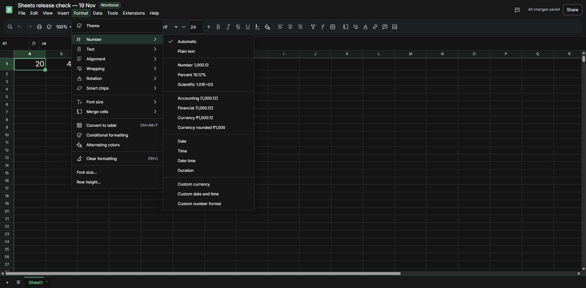

# Sheets screenshot expansion — 19 November 2026

The Google Sheets reference screenshots were used to expand Schedora's native spreadsheet tools. This is a feature and behavior implementation within Schedora; Google Workspace services are not implicitly connected.

## Included

| Area | Implemented behavior |
| --- | --- |
| Navigation | File, Edit, View, Insert, Format, Data, Tools, Extensions and Help; nested menus, familiar SVG icons, keyboard navigation and menu search |
| Files | New spreadsheet, copy, rename, sharing within the workspace, copy link, email composer link, CSV/TSV/XLSX import/export, print, history, named versions, owner-only recoverable trash and restore |
| Editing | Undo/redo, cut/copy/paste, values/format/formula/validation/transposed paste, moving rows/columns, insert/delete, find/replace, fill and editable response copies |
| View | Formula bar, gridlines and formulas; row/column freezing; groups and collapse controls; hidden tabs/rows/columns; 50–200% zoom; fullscreen |
| Insert | Cells/rows/columns/tabs, styled tables, charts, pivots, PNG-normalized cell and floating images, freehand drawings, formulas, links, checkboxes, dropdowns, emoji, static chips, comments and notes |
| Format | Fonts and 6–96 px sizes, text emphasis, horizontal/vertical alignment, overflow/wrap/clip, rotation/vertical stacking, merges, numeric/date/time formats, custom patterns/currency, conditional colors, alternating colors, borders and clearing styles |
| Data | Sheet/range/view sorting, filters and saved filter views, grouped summary view, slicer column control, server-enforced range protection, named ranges/functions, randomization, stats, validation, trim/deduplication, splitting and text extraction |
| Tools | Form creation, browser spelling, suggestion controls, recalculation, device notifications and accessibility guidance |
| Extensions | Explicitly reviewed native JSON cell-assignment automations, macro recording, saved recipes, file import and the cell-assignment editor; imported JavaScript is never executed |
| Offline | Explicit per-device opt-in; cached workbook/app resources, pending-edit recovery, reconnection sync, removal, and sign-out/account changes clearing private copies |

## Validation

- 472 unit/integration tests passed; seven optional PostgreSQL tests skipped in the ordinary run.
- 33 targeted PostgreSQL checks passed with verified TLS, including workbook permissions/protection/trash, attachments, migrations and Meet credit concurrency.
- All 38 Sheets browser journeys passed. They cover existing response linkage, collaboration/conflicts, editor sizing, formulas, exports, charts, pivots and phone layouts, plus the new menu, formatting, cleanup, named-function, paste, image, comment, automation, copy/trash and offline journeys.
- A Chrome-discovered address-entry race is fixed: background saves no longer overwrite the name box while it has focus. A browser regression check verifies range entry while a server update arrives. Duplicate toolbar font controls were removed.
- Syntax checks, Sheets type checking and the shared-source synchronization check passed. The final staging rollout and live Chrome verification are recorded below.

## Deliberate boundaries

- External data services are disabled until a connector is configured. Google Marketplace add-ons, Google Apps Script execution and Google-hosted chips/finance lookups are not connected; the native automation/chip commands describe their narrower behavior.
- Email opens the user's email composer with an access-controlled workbook link. It does not send email automatically or attach the workbook.
- Screen recording uses the browser's explicit screen picker, has no audio and downloads a local recording, with a two-minute limit. Real screen capture and device notification prompts were not automatically exercised on the user's desktop.
- Original form-response tabs remain canonical and read-only; an editable copy is available. Published-form response edits retain their separate private edit-link controls.
- Workbook bounds: 30 editable tabs, 5,000 rows, 52 columns and 2 MB of stored workbook data. Images are bounded PNG data; export does not promise complete Excel drawing/chip or formatting fidelity.
- Offline copies are optional and private to this browser profile/device, capped at ten workbooks and 8 MB per snapshot. Fresh form responses and external services require a connection. A signed-out device cannot reopen the cached private workbook. Offline copies cannot learn server-side revocation until a connection returns.

## Release compatibility

The server is deployed before the new interface. The expanded settings and formats are not readable by the previous application build. After saving new formats, use a forward fix or a compatible UI-only rollback; do not roll the backend back to task 11. The additive PostgreSQL v23 upgrade creates `workbook_trash`. Existing private uploads, EFS, scanning, email and LiveKit settings are preserved. No production cutover, Git commit, merge or push is part of this release.

## Observed staging result

CloudFormation `schedora-web-staging`: **UPDATE_COMPLETE**. ECS `schedora-web:14`: **COMPLETED**, one running task and zero pending tasks.

Final image: `255948905492.dkr.ecr.ap-south-1.amazonaws.com/schedora-web@sha256:9991f2ad83b9e260462512190bc171dbef81f2e92b0a79740aae8132348b0d58`.

The server-compatible transition build was deployed first, then the interface and the Chrome-discovered address-field correction. Task definitions preserved existing EFS mounts, scanner budgets, provider configuration, secret references and LiveKit pilot settings.

Live Chrome verification used a new private **Sheets release check — 19 Nov** workbook (`54eb69ca-309d-4e49-ba1a-9125ff7facc3`), leaving the user's earlier workbook untouched. A1 contains 20, B1 `=A1*2` returns 40, and the saved `DOUBLE(VALUE)` function makes C1 `=DOUBLE(A1)` return 40. Values, the named function, 24 px formatting and the row-height change survived reload. The final toolbar and nested menus were observed in the user's dark theme with All changes saved. The review tab remains open.

[Open the staging review workbook](https://forms.staging.schedora.in/sheets/workbooks/54eb69ca-309d-4e49-ba1a-9125ff7facc3)

The disposable local PostgreSQL container was stopped after validation. No real email/SMS, desktop screen recording, production cutover, Git commit, merge or push was performed during these Sheets checks.
